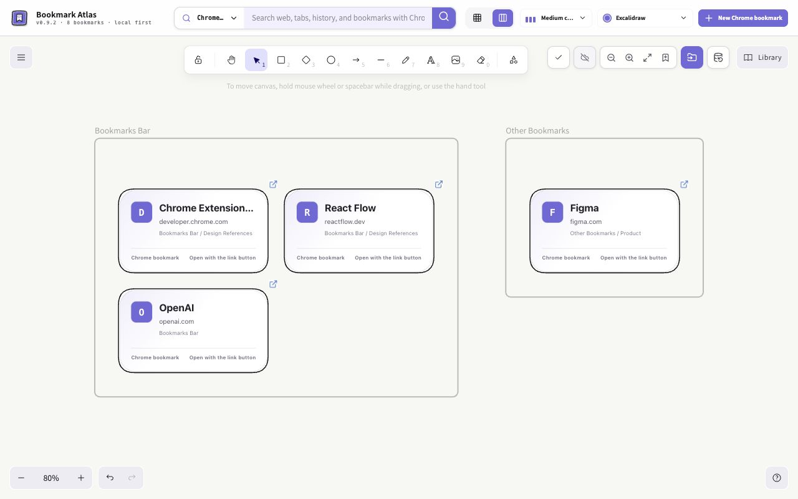

# Bookmark Atlas

A local-first Chrome and Microsoft Edge new tab workspace for your bookmarks, ideas, and everyday
research. Bring native bookmarks onto an Excalidraw canvas, arrange them beside
notes and drawings, and find your way back with one search box.

[Install for Chrome](https://chromewebstore.google.com/detail/bookmark-atlas/bkdplfepaegfdabniedlkaodllnmnbfl)
· [Install for Edge](https://microsoftedge.microsoft.com/addons/detail/cjfbcanenjlnfenoajkfhdfnhmclboai)
· [Website](https://xixi-kitchen.github.io/bookmark-atlas/)
· [Guide](https://xixi-kitchen.github.io/bookmark-atlas/guide.html)
· [Updates](https://xixi-kitchen.github.io/bookmark-atlas/changelog.html)
· [Privacy](https://xixi-kitchen.github.io/bookmark-atlas/privacy.html)
· [Support](https://xixi-kitchen.github.io/bookmark-atlas/support.html)
· [简体中文](#中文说明)



Chrome Web Store stable: **v0.9.6**, published on **2026-10-22**.
Practice on the real canvas with the optional learning guide and read complete
bilingual version introductions. The
[v0.9.6 release](https://github.com/xixi-kitchen/bookmark-atlas/releases/tag/v0.9.6)
includes the matching package, checksum, and release notes; previous releases remain available.

Microsoft Edge Add-ons stable: **v0.9.7**, confirmed publicly available on **2026-10-28**.
Use the [Edge guide](https://xixi-kitchen.github.io/bookmark-atlas/edge/guide.html) and
[Edge release](https://github.com/xixi-kitchen/bookmark-atlas/releases/tag/edge-v0.9.7).
Local Edge functionality is accepted; two-device Edge sync acceptance remains pending.
Choose the matching browser store; profiles, favorites and saved AI settings do not migrate automatically.

## Quick start

1. Install from the Chrome Web Store and open a new tab. In the canvas, click
   **Import bookmarks** and choose individual bookmarks or a folder; choose icon,
   compact, or detailed cards.
2. On a page you want to keep, open the extension icon and choose **Add to
   canvas**. Pin the icon in Chrome for easy access. The popup can open the canvas
   after adding, or keep you on the current page until your next canvas visit.
3. Click a card's website icon to open it. Select multiple cards on the canvas
   to move and arrange them together, then add notes, drawings, or frames.
4. Optionally configure your own AI service for organization suggestions. Review
   the selected metadata before sending, preview the result, and apply it when
   you are ready. The website [guide](https://xixi-kitchen.github.io/bookmark-atlas/guide.html)
   covers the workflow; **Settings → Learning guide** offers optional in-app practice.

## What you can do

The new tab is a full Excalidraw workspace, not only a bookmark dashboard.
Use **More tools → Embed** to place interactive webpages and videos beside your notes.
Bilibili and YouTube links have dedicated adaptations; provider embedding, sign-in,
region and playback restrictions still apply. See the [embed guide](https://xixi-kitchen.github.io/bookmark-atlas/guide.html#embeds).
You can [star the project](https://github.com/xixi-kitchen/bookmark-atlas) or
[request another website adaptation](https://github.com/xixi-kitchen/bookmark-atlas/issues/new/choose).

- Manage native Chrome bookmarks in a sidebar or on a freeform canvas, including
  folders, search, ordering, and timed undo for bookmark changes.
- Use Excalidraw's drawing tools, text, images, frames, links, undo/redo,
  import/export, and full canvas backups.
- Search bookmarks, open tabs, and browsing history locally. Search submissions
  go to the selected provider; supported built-in engines can offer remote
  suggestions. The default follows Chrome's search service.
- Keep web pages and supported YouTube/Bilibili players on the canvas. Embedded
  sites must allow iframes and retain their own privacy and account behavior.
- Choose English or Simplified Chinese, canvas themes, and card presentation
  preferences. Optional AI previews do not rearrange native bookmarks.

## Your data and sync

The complete canvas and attachments are saved on your device. Lightweight canvas
content—shapes, text, bookmark references, document settings, and library items—can
sync when Chrome Sync is enabled and quota allows. Use the same Chrome account
with the relevant sync settings enabled on each device. Sync is event-driven and
usually near real time, with **no fixed delivery guarantee**. Images and binary
attachments stay on the device where they were added; export a full backup for
a complete copy. Viewport and drawing-tool preferences stay local.

Current-page capture reads the active page's title and URL only when requested,
adds a native bookmark under **Other bookmarks / Bookmark Atlas**, and queues its
canvas insertion locally until the canvas saves. It does not read page bodies or
rearrange unrelated bookmarks. Native bookmark sync follows Chrome's settings.

AI is optional and requires your own compatible HTTPS endpoint, model, and API
key. Provider fees and data policies apply, including possible charges for model
tests. After your explicit agreement, only selected card titles, domains, notes,
card IDs, and your instruction are sent. Full URLs, folder paths, browsing history,
other tabs, images, and the rest of your canvas are excluded. The API key is sent
as authentication, never in the prompt.

Explicitly saved AI settings stay local; the key is encrypted with AES-GCM using
a device-local key. Configuration and keys are excluded from sync and extension
backups. This is **not an OS keychain**: someone controlling the browser profile
or extension runtime may still gain access. Clear local AI settings removes the
saved configuration and credential. See the [privacy policy](PRIVACY.md) for
permissions, remote requests, storage, and deletion details.

Bookmark Atlas has no ads or trackers and does not send your bookmarks, tabs,
history, or canvas to a developer server by default.

## Browser availability

| Browser | Status |
| --- | --- |
| Chrome | Available through the Chrome Web Store. |
| Microsoft Edge | Available from Microsoft Edge Add-ons (v0.9.7). Local functionality accepted; same-account two-device sync acceptance remains pending. |
| Safari | WebExtension build feasibility only; Apple packaging, runtime validation, and a separate sync design remain required. |

There is no synchronization between different browser families.

## Development and contribution

```bash
npm ci --ignore-scripts
npm exec -- wxt prepare
npm run dev
```

For a production build and the project checks:

```bash
npm run check
```

Load `output/chrome-mv3/` through **chrome://extensions → Developer mode → Load
unpacked**. Use a separate test profile with sample bookmarks when testing data
changes. `npm run check:edge` and `npm run check:safari` validate their respective
build candidates; a passing build does not establish browser support.

[Report a bug or suggest a feature](https://github.com/xixi-kitchen/bookmark-atlas/issues/new/choose)
with your browser, extension version, installation source, and steps to reproduce.
Remove private URLs, bookmark content, account details, and API keys from logs and
screenshots. Read [CONTRIBUTING.md](CONTRIBUTING.md) for focused changes and
verification, or the [release process](docs/release-process.md) for publishing.

## 中文说明

Bookmark Atlas 是本地优先的 Chrome 与 Microsoft Edge 新标签页工作空间。将原生书签放进
Excalidraw 画布，与备注、绘图和网页嵌入一起整理，再通过统一搜索找回需要的内容。

[从 Chrome 应用商店安装](https://chromewebstore.google.com/detail/bookmark-atlas/bkdplfepaegfdabniedlkaodllnmnbfl)
· [从 Edge 加载项安装](https://microsoftedge.microsoft.com/addons/detail/cjfbcanenjlnfenoajkfhdfnhmclboai)
· [官网](https://xixi-kitchen.github.io/bookmark-atlas/)
· [中文官网](https://xixi-kitchen.github.io/bookmark-atlas/zh/index.html)
· [使用指南](https://xixi-kitchen.github.io/bookmark-atlas/zh/guide.html)
· [更新记录](https://xixi-kitchen.github.io/bookmark-atlas/zh/changelog.html)
· [隐私政策](https://xixi-kitchen.github.io/bookmark-atlas/zh/privacy.html)
· [支持](https://xixi-kitchen.github.io/bookmark-atlas/zh/support.html)

Chrome 商店当前稳定版为 **v0.9.6**，已于 **2026-10-22** 上架。
本版提供真实画布上的可选实操引导，以及完整双语版本介绍。
[v0.9.6 正式发布页](https://github.com/xixi-kitchen/bookmark-atlas/releases/tag/v0.9.6)
提供对应安装包、校验文件和发布说明；历史版本继续保留。

Edge 当前正式版为 **v0.9.7**，已于 **2026-10-28** 核实公开可安装。
查看 [Edge 中文指南](https://xixi-kitchen.github.io/bookmark-atlas/zh/edge/guide.html)与
[Edge 正式发布页](https://github.com/xixi-kitchen/bookmark-atlas/releases/tag/edge-v0.9.7)。
本机功能已验收，双设备同步仍待测试。请选择对应浏览器商店；原生收藏、画布及 AI 配置不会跨浏览器自动迁移。

### 快速开始

1. 从商店安装后打开新标签页，在画布中点击「导入书签」，选择单条书签或文件夹，再选择图标、简洁或详细卡片。
2. 浏览网页时点击扩展图标，选择「添加到画布」。可将图标固定在 Chrome 工具栏；
   弹窗支持添加后打开画布，也可留在当前网页，稍后打开画布集中整理。
3. 单击卡片的网站图标打开网页；在画布上多选卡片，一起移动、排布，再添加备注、绘图或框架。
4. 需要时自行配置 AI 服务，确认所选信息的发送范围，先预览、再决定是否应用。
   [官网指南](https://xixi-kitchen.github.io/bookmark-atlas/guide.html)说明完整用法；
   「设置 → 使用指南」提供可选的应用内实操引导。

### 主要能力

新标签页中是完整的 Excalidraw 工作画布，不只是书签看板。
通过「更多工具 → 网页嵌入」可以把可交互的网页或视频放在笔记旁边。
已为 Bilibili 和 YouTube 链接做专门适配；网站的嵌入、登录、地区与播放限制仍然适用。
详见[网页嵌入指南](https://xixi-kitchen.github.io/bookmark-atlas/zh/guide.html#embeds)。
欢迎在 GitHub 收藏项目，或通过 [Issue](https://github.com/xixi-kitchen/bookmark-atlas/issues/new/choose)申请其他网站适配。

- 在侧边栏或自由画布中管理 Chrome 原生书签，支持文件夹、查找、排序和书签操作的限时撤销。
- 使用完整 Excalidraw 绘图能力，包括文字、图片、框架、链接、撤销重做、导入导出和完整备份。
- 本地搜索书签、已打开标签页和浏览历史。提交搜索时连接所选搜索服务；
  部分内置搜索引擎可提供远程联想，默认跟随 Chrome 搜索服务。
- 嵌入允许 iframe 的网页和支持的 YouTube/Bilibili 播放器，目标网站的隐私与账号规则仍然适用。
- 选择简体中文或 English、主题和卡片样式。可选 AI 提供画布整理预览，不重新整理原生书签。

### 数据与同步

完整画布及附件保存在当前设备。开启 Chrome Sync 且配额允许时，图形、文字、书签引用、
文档设置和素材库等轻量内容可以同步；请在各设备登录同一 Chrome 账号并开启相关同步设置。
同步由事件驱动，通常接近实时，**不承诺固定到达时间**。图片和二进制附件仅在添加它们的设备上保存，
需要完整副本时请导出完整备份。视口和绘图工具偏好仅保存在本机。

主动收藏当前网页时，仅读取活动标签页的标题和网址，保存到原生「其他书签 / Bookmark Atlas」，
在本机等待画布成功保存后完成添加；不读取网页正文，不移动无关书签。原生书签遵循 Chrome 的同步设置。

AI 为可选功能，需自备兼容的 HTTPS 接口、模型和 API Key，服务商可能收费，模型测试也可能产生费用。
你明确同意后，仅发送所选卡片的标题、域名、备注、卡片 ID 和整理要求；
不发送完整网址、文件夹路径、浏览历史、其他标签页、图片和其余画布。Key 仅用于认证，不进入提示词。

明确保存的 AI 配置仅留本机；Key 通过本机密钥以 AES-GCM 加密，配置和密钥均不同步、不进入扩展备份。
这**不是操作系统钥匙串**，控制浏览器用户配置或扩展运行环境的人仍可能获得访问能力。
「清除本机 AI 配置」会删除已保存配置和凭据。
[隐私政策](PRIVACY.md)说明完整权限、远程请求、存储与删除边界。

Bookmark Atlas 无广告或追踪器，默认不将书签、标签页、历史或画布发送到开发者服务器。

### 浏览器与开发

Chrome v0.9.6 和 Edge v0.9.7 已分别通过各自商店提供。Edge 本机功能已验收，同账号双设备同步仍待测试；
Safari 仅完成 WebExtension 构建可行性验证，仍需 Apple 打包、运行验证与独立同步方案。
**不同浏览器之间不会同步数据。**

运行 `npm ci --ignore-scripts`、`npm exec -- wxt prepare`、`npm run dev` 开发，运行 `npm run check` 完成类型检查、测试和 Chrome 构建验证。
在 `chrome://extensions` 开启开发者模式，以「加载已解压的扩展程序」选择 `output/chrome-mv3/`。
涉及数据修改时请使用单独的测试配置与示例书签。Edge 和 Safari 构建命令分别为
`npm run check:edge`、`npm run check:safari`，构建通过不等于正式支持。

请通过 [GitHub Issues](https://github.com/xixi-kitchen/bookmark-atlas/issues/new/choose)
提供浏览器与扩展版本、安装来源及复现步骤，并在日志或截图中移除私密网址、书签、账号信息和 API Key。
贡献流程见 [CONTRIBUTING.md](CONTRIBUTING.md)，发布流程见 [release-process.md](docs/release-process.md)。
