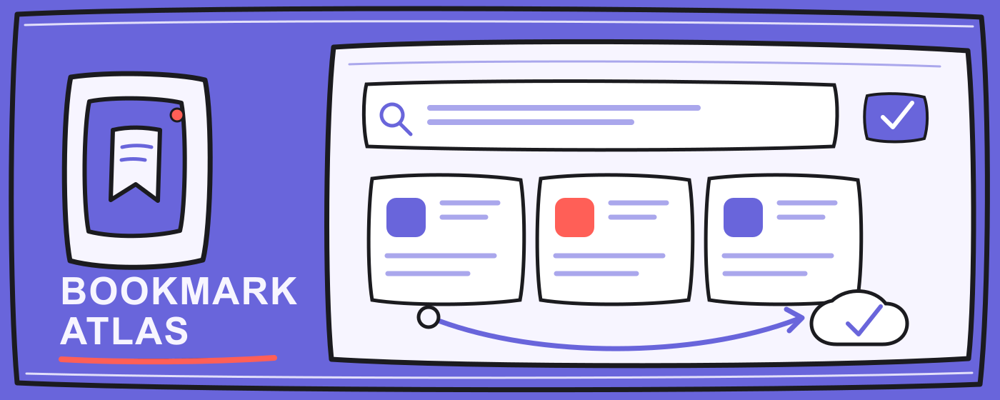

# Bookmark Atlas

Bookmark Atlas is a local-first Chrome new tab extension that combines Chrome
bookmarks, search, persistent web embeds, and a full Excalidraw canvas.

[Install from Chrome Web Store](https://chromewebstore.google.com/detail/bookmark-atlas/bkdplfepaegfdabniedlkaodllnmnbfl)
· [Changelog](CHANGELOG.md)
· [Support](SUPPORT.md)
· [Report a bug](https://github.com/xixi-kitchen/bookmark-atlas/issues/new/choose)



简体中文说明见本文件下方的「中文说明」。

## v0.9.5 Release Candidate

The v0.9.5 candidate adds three canvas bookmark presentations (icon,
compact, detailed), canvas-only notes, direct icon navigation, current-page
capture from the extension popup, and optional AI organization previews with
central local settings. User acceptance is complete; Chrome Web Store submission
and review are pending. The store link may still serve v0.9.4 until the update
is approved and published. See the [v0.9.5 notes](docs/releases/v0.9.5.md).

Existing cards and their positions are preserved. Historical cards without a
presentation field retain the detailed style; new imports default to compact.
Settings can change the default for future imports. Detailed cards include a
shortened URL, and clicking a favicon opens a new tab without sacrificing drag.

Settings includes Follow browser / 简体中文 / English. Language switches in place
without reloading the canvas and is remembered locally for extension pages and
the capture popup. It does not change Chrome's own interface language.

AI is optional and requires your own Chat Completions-compatible HTTPS Base URL,
model name, and API key. Connect requests permission only for the configured
service origin. After selecting cards and explicitly approving the outgoing
scope, the request sends their titles, domains, notes, card IDs, and your
instruction—not full URLs, folder paths, query/fragment values, history, other
tabs, images, or the rest of the canvas. The key is an authentication header,
never a prompt field. An explicit Save on this device action saves Base URL and
model locally and encrypts the API key with AES-GCM-256, a fresh 96-bit IV, and
authenticated binding to the normalized endpoint. Only the ciphertext and IV
are stored with the endpoint in `chrome.storage.local`; a locally generated,
non-extractable CryptoKey is kept in the extension's dedicated IndexedDB, not
bundled in the package. Configuration and encryption keys are not synced,
shared, or included in extension backups. This is not an OS keychain or absolute
protection: someone controlling the browser profile or extension runtime may
still invoke or recover access to the credential. Closing a panel does not
delete saved settings; Clear local AI settings removes saved configuration and
credentials. The non-credential encryption key remains locally for concurrent
operations and contains no provider token; uninstall removes extension storage.
Existing plaintext development settings migrate only after encryption and
replacement succeed. If IndexedDB or encryption is unavailable, an explicit
error is shown; the extension does not silently retain plaintext or switch to
session-only storage.

Fetch models requests `GET /models` only when clicked, with manual model entry
available if the provider does not support it. Listing success does not prove
that a model can generate. Test selected model independently sends a fixed
minimal `POST /chat/completions` prompt, without bookmarks, and may incur charges.
Neither discovery nor testing automatically saves settings.

On an ordinary HTTP/S page, click the extension icon and choose Add to canvas.
The active tab's title and URL are saved to the native Other bookmarks /
Bookmark Atlas folder and queued locally for insertion into the Excalidraw
canvas. The intent remains pending until the canvas saves successfully. Capture
does not read page bodies or move or rewrite unrelated bookmarks. Native
bookmarks follow your browser's usual bookmark-sync settings; the pending queue
itself is not synced or shared by the extension.

The popup remembers Open canvas after adding on this device (enabled for new
profiles to preserve the previous behavior). Uncheck it to stay on the current
page. Captures remain safely queued until a canvas is opened; they are not
declared saved to the cloud before the normal canvas consumer completes.

Review your provider's fees, privacy, retention, and training terms. Metadata-only
AI suggestions are not verified webpage summaries. Preview does not save canvas
changes; applying a plan is explicit and undoable and does not reorganize native
browser bookmarks. The user has completed real-use acceptance of this candidate,
including AI organization; this does not guarantee compatibility with every
provider or model. Store submission must use matching privacy, data-use, and
optional-permission disclosures; source documentation alone is not evidence of
store publication.

## Features

- Manifest V3 new tab override.
- Reads and manages the current Chrome profile's native bookmark tree.
- Supports creating, editing, moving, sorting, deleting, and timed undo for
  bookmark changes.
- Keeps Excalidraw's native drawing, text, image, frame, link, undo/redo,
  import/export, zoom, and collaboration UI.
- Saves the full canvas and binary attachments to local IndexedDB, with
  `chrome.storage.local` as a fallback.
- Writes lightweight canvas state to Chrome Sync when quota allows: shapes,
  text, bookmark references, document settings, and library items are
  compressed and chunked. Viewport, zoom, sidebar, drawing-tool preferences,
  images, and binary attachments remain local to the device where they were
  added.
- Chrome Sync updates are event-driven and near real time when Chrome sync is
  available, but Chrome does not guarantee an exact delivery latency across
  devices or open tabs.
- Reconciles synced bookmark cards by normalized URL, title, and folder path
  instead of treating Chrome's profile-local bookmark IDs as cross-device keys.
- Shows Chrome bookmark folders in list and Excalidraw views, with folder
  navigation, breadcrumbs, group import, drag sorting, cross-folder movement,
  and precise same-folder ordering.
- Lets the search box show remote suggestions for supported built-in engines
  plus local results from open tabs, browsing history, and Chrome bookmarks.
- Follows the current Chrome default search service by default. Users may
  switch to Baidu, Bing, Google, or a safe custom search template.
- Uses Chrome's local favicon cache for bookmark cards and search engines, with
  text fallbacks when an icon is unavailable.
- Allows HTTPS web embeds and local development URLs. Custom iframes are
  sandboxed so embedded pages cannot navigate the extension's top-level page or
  escape through popups.
- Converts YouTube watch, Shorts, live, and playlist URLs into official iframe
  players when possible.
- Shows Bilibili home and regular pages directly. Bilibili video URLs are
  converted to the official player with autoplay disabled, and can be switched
  to a protected full video page from the embed toolbar.
- Gives new installs an optional three-step guide inside the real workspace;
  Settings can replay it and show the current release notes.
- Defaults to the Excalidraw theme. Settings also offers Swiss, Bauhaus, Surreal,
  Memphis, Pop, and Pixel themes, grid card sizes, and search engine management.
- Keeps native Excalidraw zoom controls; More canvas actions contains fit-all,
  focus-bookmarks, and full backup.

## Local Development

```bash
npm install
npm run dev
```

## Verification and Build

```bash
npm run check
npm run check:edge
npm run check:safari
```

The unpacked extension build is written to the visible directory
`output/chrome-mv3/`. In `chrome://extensions`, enable Developer mode, choose
"Load unpacked", and select that directory.

- `output/edge-mv3/` is an Edge compatibility candidate. It is not advertised
  as supported until real sideload and same-account two-device testing pass.
- `output/safari-mv3/` proves the WebExtension can be built, not that it is
  ready for Safari distribution. Safari still requires Apple packaging,
  runtime API testing, and a separate iCloud/CloudKit design for Safari-to-Safari
  canvas synchronization.
- Bookmark Atlas does not synchronize data between different browser families.

## Permissions

- `bookmarks`: display and manage Chrome bookmarks that the user acts on;
  current-page capture creates its bookmark in Other bookmarks /
  Bookmark Atlas without rearranging unrelated bookmarks.
- `favicon`: read website icons from Chrome's local favicon cache.
- `storage`: save settings, local fallback canvas data, and lightweight synced
  canvas state; also use local-only pending capture intents
  and explicitly saved AI endpoint/model/API Key settings.
- `search`: use the user's current Chrome search service without changing the
  browser's default search settings.
- `tabs`: match and switch open tabs in the pre-search panel; capture
  reads the active page's title and URL only on explicit request in the popup.
- `history`: match browsing history in the pre-search panel.
- `declarativeNetRequestWithHostAccess` and the exact YouTube host permission:
  add a fixed Bookmark Atlas client referrer only to official YouTube `/embed/`
  player requests created by the extension.
- Exact host permissions for Baidu, Bing, and Google suggestion endpoints:
  fetch remote suggestions only when the user selects the corresponding built-in
  search engine.
- Optional AI: optional `https://*/*` capability allows user-selected
  compatible endpoints, but is not granted for every site at installation.
  Clicking Connect requests only the configured service origin, not access to
  arbitrary webpage bodies. Model responses are validated data, not remote code.

Current-page capture reuses existing `tabs`, `bookmarks`, and `storage` grants;
it does not add a new installation-time permission.

Web embeds still follow each website's own iframe policy. If a site blocks
embedding with `X-Frame-Options` or CSP `frame-ancestors`, the browser will
block display; an extension cannot override that safely.

Bookmark Atlas does not read page body content, sell user data, include ads or
trackers, or execute remote extension code. Optional AI sends only user-approved
selected metadata to the chosen provider; its own data policies apply.

## 中文说明

Bookmark Atlas 是一个本地优先的 Chrome 新标签页扩展，把 Chrome 书签、
搜索、网页嵌入和完整 Excalidraw 画布放在同一个工作空间里。

[从 Chrome 应用商店安装](https://chromewebstore.google.com/detail/bookmark-atlas/bkdplfepaegfdabniedlkaodllnmnbfl)
· [更新日志](CHANGELOG.md)
· [获取帮助](SUPPORT.md)
· [反馈问题](https://github.com/xixi-kitchen/bookmark-atlas/issues/new/choose)

### v0.9.5 发布候选

v0.9.5 候选增加了图标、简洁、详细三种书签展示、画布备注、单击图标打开、扩展图标收藏当前网页和带集中本机设置的可选 AI 整理预览。用户已完成使用验收，商店提交及审核待完成；批准并发布前，商店链接可能仍提供 v0.9.4。见 [v0.9.5 发布说明](docs/releases/v0.9.5.md)。

旧卡片与原位置保持不变，没有展示字段的历史卡片沿用详细形式，新导入默认简洁，可在设置中更改未来导入的默认值。详细卡片包含缩略网址，单击图标可新标签页打开，同时保留拖动。

设置中可选择「跟随浏览器 / 简体中文 / English」，切换不刷新或重新挂载画布。语言仅记在本机，扩展页面与收藏弹窗共用，不更改 Chrome 自身的界面语言。

AI 默认不启用，需自配兼容 Chat Completions 的 HTTPS 接口、模型和 API Key。点击连接只申请配置服务实际 origin 的权限；选中卡片并明确同意后，才发送其标题、域名、备注、卡片 ID 和整理要求。不发送完整网址、文件夹路径、网址参数或片段、历史记录、其他标签页、图片或其余画布。Key 仅用于认证请求头，不进入提示词。明确「保存到本机」后，接口和模型保存在本机，API Key 使用 AES-GCM-256、每次全新 96 位 IV 加密，并以规范化接口地址进行认证绑定；`chrome.storage.local` 中的凭据仅保留密文、IV 和接口地址，本机生成、不可导出的 CryptoKey 存于扩展专用 IndexedDB，不内置在安装包中。配置和加密密钥均不同步、不共享、不进入扩展备份。这不是操作系统钥匙串或绝对防护；完全控制浏览器用户配置或扩展运行环境的人仍可能调用或恢复凭据访问。关闭面板不会删除已保存配置；清除本机 AI 配置会删除已保存配置和凭据，为并发操作保留的不含服务商 token 的加密密钥不会一并删除；卸载会移除扩展存储。旧开发版明文配置只有成功加密并替换后才继续使用；IndexedDB 或加密不可用时明确报错，不回退明文，也不静默改为仅会话保存。

主动「拉取模型」通过 `GET /models` 获取列表，服务商不支持时仍可手动填模型。列表成功不代表模型可以生成；独立的「测试所选模型」通过 `POST /chat/completions` 只发送固定简短提示、不传书签，可能收费。这两项操作均不会自动保存设置。

打开普通 HTTP/S 网页，点击 Chrome 的扩展图标并选择添加到画布：扩展读取活动标签页的标题和网址，保存到原生「其他书签 / Bookmark Atlas」并在本机排队添加至 Excalidraw，画布成功落盘后才确认任务完成。不读取网页正文，不移动或改写其他书签。原生书签仍按用户的浏览器书签同步设置管理，待处理队列本身不由扩展同步或共享。此功能复用已有 `tabs`、`bookmarks`、`storage` 权限，不增加安装时权限。

弹窗可勾选「添加后打开画布」，并记住本机选择。新用户默认勾选以兼容原行为；取消勾选后留在当前网页，收藏记录可靠保留，之后打开画布时自动加入，方便集中整理。没有打开画布消费时，不宣称已经同步到云端。

费用、隐私、保留期限和训练政策由所选服务商决定；根据元数据生成的是建议，不是核实后的网页摘要。预览不保存画布变更，明确应用后可撤销，不整理原生浏览器书签。用户已完成本候选版本的实际使用验收，包括 AI 整理，但这不保证所有服务商及模型都兼容。商店提交须使用一致的隐私、数据使用和可选权限披露；源文档修改不代表商店已发布。

主要能力：

- 读取并管理当前 Chrome 配置文件的原生书签树。
- 在列表视图和 Excalidraw 画布中查看、导入、移动、排序和打开书签。
- 保留完整 Excalidraw 绘图体验，包括文字、图片、框架、链接、导入导出和撤销重做。
- 完整画布和附件保存在当前设备；图形、文字、书签引用、画布文档设置和素材库在配额允许时写入 Chrome Sync。视口、缩放、侧边栏和绘图工具偏好只保存在本机。
- Chrome Sync 是事件驱动的近实时同步，但 Chrome 不承诺跨设备或多标签页的固定到达时间；图片和二进制附件只保存在添加它们的设备上。
- 搜索框可以同时显示远程联想、已打开标签页、浏览历史和 Chrome 书签。
- 普通 HTTPS 网页可以嵌入画布；iframe 会被限制，不能覆盖跳转插件页面。YouTube 和 Bilibili 视频使用官方播放器，Bilibili 视频默认关闭自动播放。
- 首次安装会显示可跳过的三步真实界面引导；设置中可随时重播引导并查看版本更新。
- 默认使用 Excalidraw 主题；设置中可切换其他主题、调整网格卡片尺寸和管理搜索引擎。
- 保留 Excalidraw 原生缩放控件；“更多画布操作”中可适应全部元素、聚焦书签和进行完整备份。

构建产物在可见目录 `output/chrome-mv3/`，可在 Chrome 扩展管理页面中作为未打包扩展加载。

Edge 构建目前是兼容性候选，在完成真实侧载和同账号双设备测试前不会对外宣称正式支持。Safari 当前只完成 WebExtension 构建可行性验证；它仍需要 Apple 打包、Safari API 实测，以及单独的 iCloud/CloudKit 同浏览器同步方案。Bookmark Atlas 不会在不同浏览器之间同步数据。
